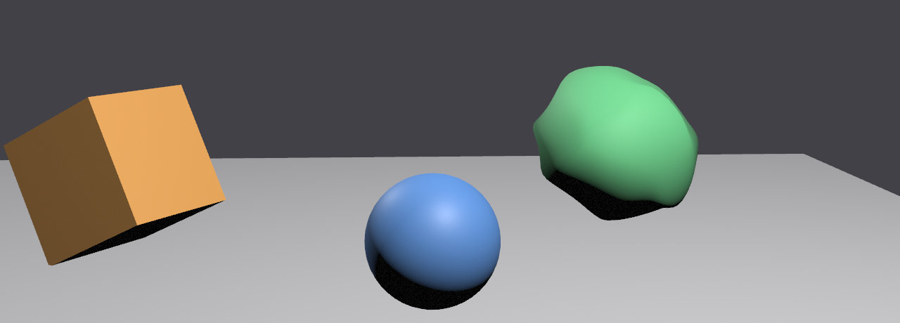

# MotionBlur-TD

TouchDesigner で、動く物・動くカメラ・変形する形に**モーションブラー**をかける tox です。

| ぼかす前 | ぼかした後 |
|---|---|
|  |  |

ゲームエンジンで標準の「速度バッファ」方式です。画素ごとに「前のフレームからどれだけ動いたか」を描き、その向きに画面をぼかします。ぼかし方は McGuire ほか「A Reconstruction Filter for Plausible Motion Blur」（I3D 2012）で、物の輪郭の内と外を分けて扱います。

- 動く物が背景にかぶる所と、動く物の向こうの背景が透けて見える所の両方を出せます
- 次の 3 つの動きが、まとめてぼけます
  - Geometry COMP の移動・回転（親の動きも含む）
  - カメラの動き
  - 形の変形（POP の点が動く形。ノイズで揺れる形など）
- **どの Render TOP の絵にも後ろからつなげます。** PBR MAT、自作の GLSL MAT、[VoxelConeTracing-TD](https://github.com/ToyoshiMorioka/VoxelConeTracing-TD) の絵など、材質を選びません

## 動作環境

- TouchDesigner 2025.33230 で確かめています（macOS）。非商用版でも動きます
- GLSL TOP・GLSL MAT・POP だけで組んでいて、ジオメトリシェーダや OS に依存する機能は使っていません。Windows でも動く作りですが、**Windows ではまだ確かめていません**

## すぐ試す

1. このリポジトリを clone するか、ZIP でダウンロードする
2. `MB_sample.toe` を開く

回る箱、左右に動く球、ノイズで揺れる緑の形、ゆっくり振れるカメラの見本が出ます。結果は `/project1/mb_sample/out`、ぼかす前は `render1` です。見本では効果が見えやすいよう、Shutter を 1.0 にしています。

## 使い方

```
ぼかしたい絵（Render TOP の出力、またはそれを重ねた絵）
    ▼
MotionBlur.tox（tox/ から読み込む。TOP と同じように線でつなぐ）
  Render：その絵を描いた Render TOP（カメラ・解像度・形の一覧をここから取る）
    ▼
露出・トーンマップなど、後ろの処理
```

- 絵がリニアな値の時は、トーンマップの前にかけてください（明るい所のぼけ方が自然になります）
- 動きを描く形は、Render の Render TOP の Geometry と同じ物です。変えたい時は Geometry に書きます（例：`geo_* glass_*`）
- 状況は Info ページの Status に出ます（形の数、飛ばした物）

### パラメータ

| ページ | パラメータ | 意味 |
|---|---|---|
| Motion Blur | Render | ぼかす絵を描いた Render TOP（カメラ・解像度・形の一覧をここから取る） |
| | Geometry | 動きを描く Geometry COMP（空白区切り、パターン可。空なら Render と同じ） |
| | Shutter | シャッターの開いている割合（初期値 0.5。1 フレームの半分の時間ぶんぼける。1 で 1 フレームぶん） |
| | Max Blur | ぼかしの最大の半径（画素、初期値 24）。速い物はここで切られる |
| | Samples | ぼかしに使う点の数（初期値 15）。多いほどなめらかで重い |
| Info | Status | 状況 |

### VoxelConeTracing-TD と組み合わせる

VoxelConeTracing-TD 側のファイルは何も変えずに、組み合わせられます。

```
1. VoxelConeTracing-TD を、このフォルダの隣に置く（…/MotionBlur-TD と …/VoxelConeTracing-TD）
    ▼
2. Textport（Alt+T / Option+T）で次を実行する
   exec(open(project.folder + '/build_mb_with_vct.py', encoding='utf-8').read())
```

VCT の見本（コーネルボックス）が `/project1/vct_mb_sample` にでき、ガラスを重ねた絵とトーンマップの間に MotionBlur が入ります。Render は `render_opaque`、Geometry は `geo_* glass_*` です。

## しくみ

```
MotionBlur
    │
    ├─ slotN（形 1 つにつき 1 つ。毎フレームの処理が作り直す）
    │    元の POP・SOP をそのまま使い、前のフレームの点の位置 PrevP を付ける
    │    （点が動いている形にだけ Feedback POP をつなぐ。止まっている形では計算が走らない）
    │    材質：形の世界での行列とカメラの、今と前のフレームの分を、毎フレームの処理が入れる
    │
    ├─ velocity（Render TOP）：今と前のフレームの位置を画面に写した差（画素）と奥行き
    │
    ├─ tilemax_x → tilemax → neighbormax：Max Blur 画素四方のタイルごとの最大の動き（横と縦に分けて求める）
    │
    └─ reconstruct：まわりのいちばん大きな動きの向きに点を取り、奥行きと動きで重みを付けて平均する
```

## 速さ

手元の Mac・1280×720 で測った GPU 時間です。

- 見本（形 4 個）：約 0.7 ms
- VoxelConeTracing-TD の見本（形 10 個）に足した時：MotionBlur 自体は 1 ms 弱。VCT と合わせて 59 fps

形ごとの計算は、点が動いている形の分しかかかりません。

## 制限

- **何も描かれていない所（背景色の所）は、動きが 0 になります。** カメラが動いても、空や背景色はぼけません。床や壁など、形があればぼけます
- **点の数が変わる形**（生まれて消える粒子など）は、点の番号がずれるため、変わったフレームは変形の分の動きが 0 になります。数が変わらずに番号が入れ替わる形も、動きが正しくありません
- インスタンスで並べた形には対応していません
- 半透明の物は、いちばん手前の物の動きでぼけます
- ぼかしは絵の上で行うので、ぼけている間の光り方の変化（回る物のハイライトの動きなど）は出ません

## tox と見本を作り直す

このフォルダに .toe を保存してから（または `MB_sample.toe` を開いて）、Textport で次を実行します。

```python
exec(open(project.folder + '/build_mb_tox.py', encoding='utf-8').read())     # tox/MotionBlur.tox を作る
exec(open(project.folder + '/build_mb_sample.py', encoding='utf-8').read())  # 見本を /project1/mb_sample に組む
```

.toe が別のフォルダにある時は、先に `MB_ROOT = 'C:/.../MotionBlur-TD'` を実行してください（`\` ではなく `/` で書きます）。
シェーダは `shaders/` のファイルを書き換えて、組み立てスクリプトを実行し直すと tox に入ります。

開発中に確かめたことは [`docs/NOTES_ja.md`](docs/NOTES_ja.md) にまとめています。

## ファイル

| ファイル | 中身 |
|---|---|
| `MB_sample.toe` | 見本 |
| `tox/MotionBlur.tox` | MotionBlur |
| `build_mb_tox.py`・`build_mb_sample.py`・`build_mb_with_vct.py` | tox・見本・VCT との組み合わせの見本の組み立てスクリプト |
| `scripts/mb_runtime.py` | MotionBlur の中で毎フレーム動く処理 |
| `shaders/` | シェーダ（前のフレームの位置、動きを描く材質、タイルの最大、ぼかし） |
| `docs/NOTES_ja.md` | 開発メモ |

## 参考

- Morgan McGuire, Padraic Hennessy, Michael Bukowski, Brian Osman. "A Reconstruction Filter for Plausible Motion Blur." I3D 2012.

## ライセンス

[MIT](LICENSE)
